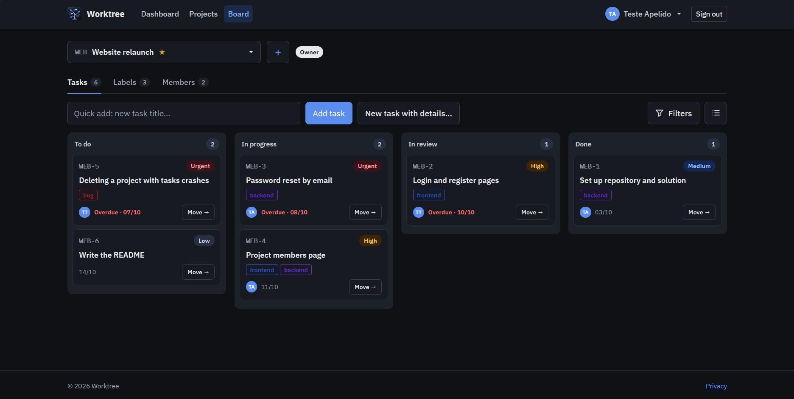
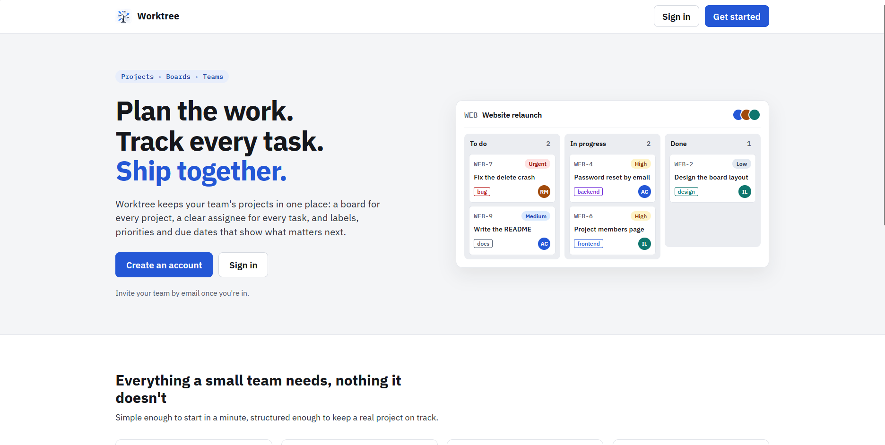
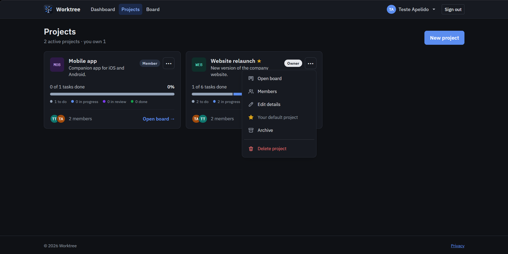
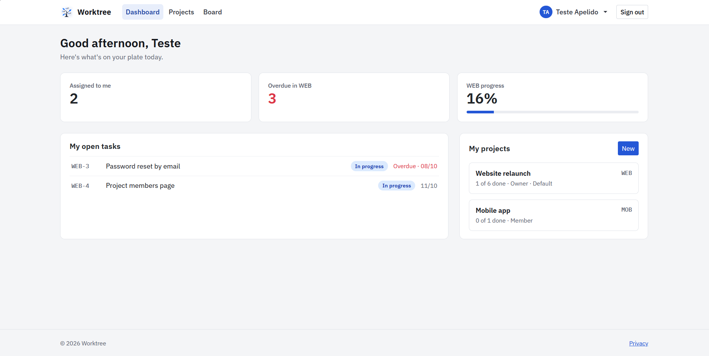
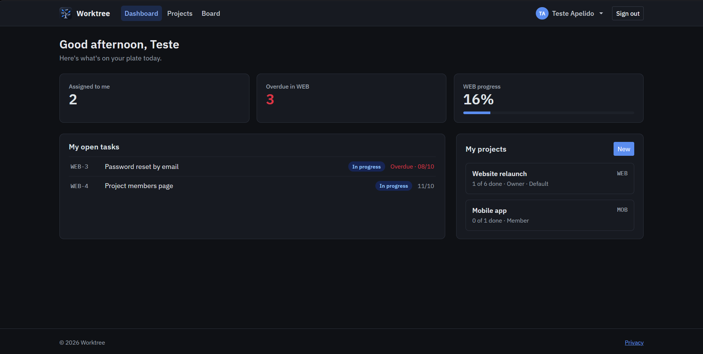
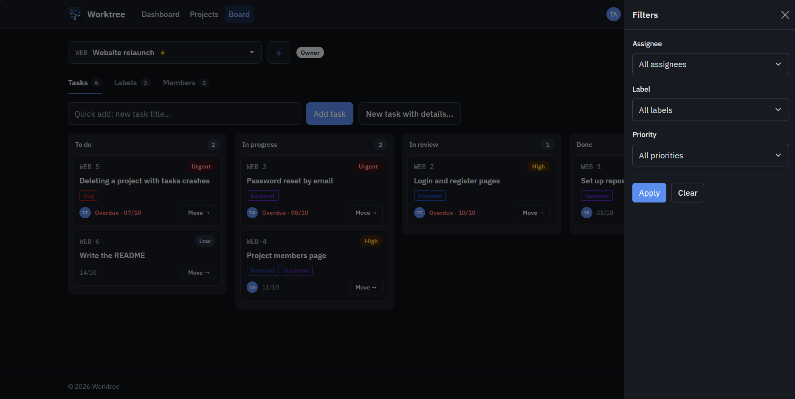
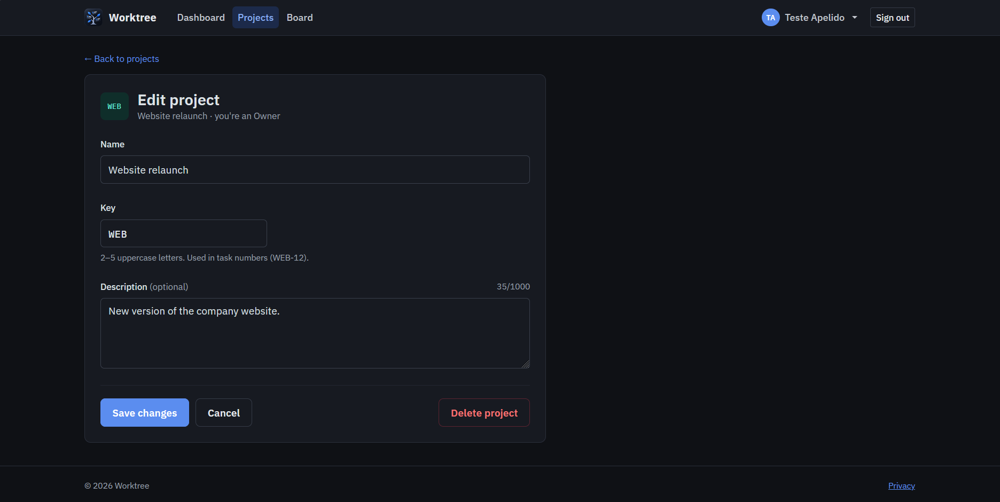
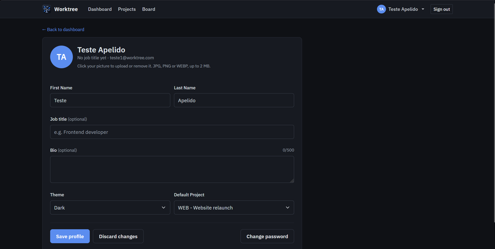

# Worktree

Kanban-style project and task manager built with ASP.NET Core MVC, Entity Framework Core and SQL Server.
Final project for UFCD 5417 (CET 105 – CINEL).



## Features

### Accounts
- [x] Register, login and logout (ASP.NET Core Identity)
- [x] Sign in with Google (optional, see setup below)
- [x] Forgot / reset password by email (MailKit + SMTP)
- [x] Change password
- [x] Profile: name, job title, bio, theme, default project
- [x] Profile picture upload (JPG, PNG or WEBP, up to 2 MB)
- [x] Light and dark mode

### Projects and members
- [x] Create, edit, archive and delete projects, each with a unique key (WEB, MOB…)
- [x] The creator becomes the Owner; Owners add members by email and change roles (Owner / Member)
- [x] Only members can see a project; anyone else gets a 404
- [x] A project always keeps at least one Owner
- [x] Projects with tasks can't be deleted; they can be archived (read-only) instead

### Tasks, labels and comments
- [x] Tasks numbered per project (WEB-1, WEB-2…) with status, priority, due date, assignee and labels
- [x] Assignees must be members of the project
- [x] Labels per project with a colour picker and live preview; label names are unique inside a project
- [x] Comments on tasks; only the author can edit or delete them

### Board and dashboard
- [x] Kanban board with To do / In progress / In review / Done columns
- [x] Project picker, quick add, "Move →" menu on each card
- [x] Filters panel: assignee, label and priority
- [x] Labels and Members tabs inside each board
- [x] Dashboard with tasks assigned to me, overdue tasks and project progress
- [x] Task list view

## Data model

| Relationship | Example |
|---|---|
| 1:1 | `User` – `UserProfile` |
| 1:N | `Project` → `TaskItem`, `Project` → `Label`, `TaskItem` → `Comment` |
| N:N | `User` ↔ `Project` through `ProjectMember` (with a role), `TaskItem` ↔ `Label` through `TaskLabel` |

Data access goes through repositories (`GenericRepository<T>` plus one repository per entity), so controllers never use the `DataContext` directly.

## Tech stack
- ASP.NET Core MVC (.NET 8)
- Entity Framework Core 8 + SQL Server (LocalDB)
- ASP.NET Core Identity, Google authentication
- MailKit (SMTP)
- Bootstrap 5, IBM Plex Sans / Mono

## Getting started
1. Clone the repository and open `Worktree.slnx` in Visual Studio 2022.
2. Check the connection string in `Worktree/appsettings.json` (LocalDB by default).
3. Set the mail password with User Secrets (needed for password recovery emails):
   ```
   dotnet user-secrets set "Mail:Password" "<your app password>"
   ```
4. Optional, for "Continue with Google":
   ```
   dotnet user-secrets set "Authentication:Google:ClientId" "<client id>"
   dotnet user-secrets set "Authentication:Google:ClientSecret" "<client secret>"
   ```
   Without these the Google button is simply hidden.
5. Run the project. The database is created, migrated and seeded automatically.

## Demo accounts

| Email | Password | Role |
|---|---|---|
| teste1@worktree.com | `Teste123!` | Owner of **WEB** (Website relaunch), Member of **MOB** |
| teste2@worktree.com | `Teste123!` | Owner of **MOB** (Mobile app), Member of **WEB** |

New passwords need at least 8 characters, with an uppercase letter, a number and a symbol.

## Screenshots

| | |
|---|---|
|  |  |
|  |  |
|  |  |
|  | |
